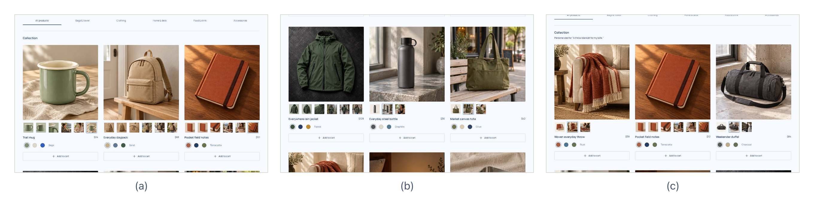
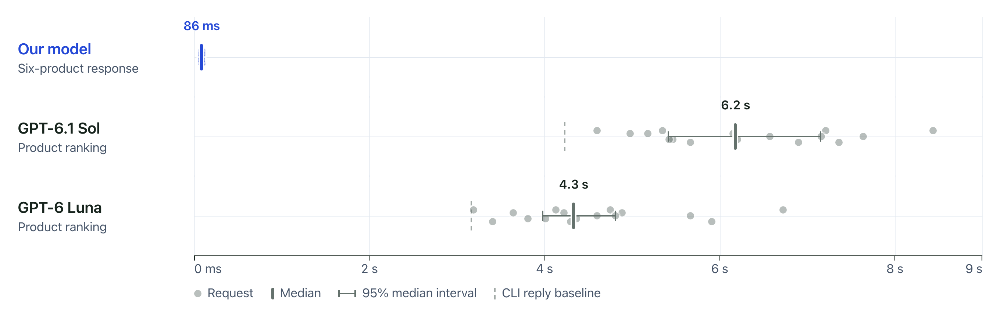
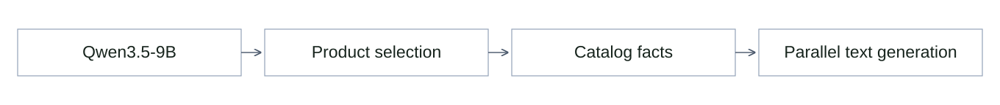

# Personalization Labs

Personalization Labs is a DubHacks 2026 project that tests personalized storefronts.
A local model selects products and colors and writes copy from catalog facts.
AI shoppers browse the resulting pages, and the evaluation compares their shopping
outcomes with those from the generic store.



Figure 1. The demo store before and after personalization: (a) the initial
collection, (b) the blanket below the first row, and (c) the blanket ranked first.

## The results

| Result | What we measured |
| --- | --- |
| **+3.78% merchandise value per session** | **$42.35 → $43.95** in a synthetic benchmark: 60 paired scenarios, 120 assigned sessions. |
| **86 ms warm personalization** | **85.5 ms median** backend time across 10 six-card requests, with warm input encoding and fresh ranking/copy on every request. |
| **139 ms to visible personalized products** | **138.8 ms median** to three fully visible cards with decoded images across 10 loaded-shop profile switches. |
| **35 products · 105 color variants** | The current demo selects real catalog variants and produces 20 fresh factual fields for a six-card response. |
| **29/32 correct first choices** | The earlier balanced ranker audit improved from **14/32**, with the target present in the top six for **32/32** requests. |

The value benchmark used the frozen 16-product store. The speed measurements used
the expanded 35-product demo; warm backend timing excludes startup, network,
browser and images. [Sources, methodology and full outcomes](docs/RESULTS.md).

## Request latency



Figure 2. Request latency for 10 warm local six-card responses and 16 ranking
requests per hosted model. Bars mark medians and 95% bootstrap intervals; dashed
lines mark trivial CLI replies. The local clock measures backend work; the hosted
clock measures ranking through the client.
[Data and timing scope](docs/RESULTS.md#speed-graph).

## System overview

Fieldwork is the demo store. It has product galleries, color controls, a cart and
simulated checkout. AI shoppers use screenshots to browse, search and choose
products in both the generic and personalized versions.

The evaluation records suitable purchases, abstentions, shopper actions and
merchandise value. Saved session evidence lets you inspect individual outcomes;
the dashboard compares immutable experiment snapshots across runs. Product
selection enforces budgets and supported hard constraints. Copy uses facts from
the selected catalog items.

## Model architecture



Figure 3. The model selects products and colors, then predicts copy from their
catalog facts.

Qwen3.5-9B stays frozen and supplies reusable input features. Small trained heads
score products, choose colors and predict the words for titles, badges and short
copy in parallel. Warm requests reuse exact input features, but compute new scores,
selections and words on every request. Six-card responses therefore use fresh copy
without generating each word in an autoregressive sequence.

[Serving architecture](experiments/ranker/pretrained/STORE_EXPANDED_ENGINE_V1.md) ·
[Current measurements](experiments/ranker/pretrained/expanded_store_results/v1/CURRENT_LIVE_SUMMARY.json) ·
[Experiment history](docs/DEVELOPMENT.md#measured-status)

## Run the demo

Use Node 24.11+ in the 24.x line or Node 26+, pnpm 12.5.1, and Go 1.24+ with CGO
and a C compiler. The default shop uses SQLite and requires no model weights or API key.

```sh
pnpm install
pnpm seed
pnpm dev
```

| App | Address |
| --- | --- |
| Presentation dashboard | <http://dubhacks.localhost:1356> |
| Fieldwork storefront | <http://shop.dubhacks.localhost:1356> |
| Go API | <http://api.dubhacks.localhost:1356> |

The results deck needs a configured Tiger results connection. On the configured
Apple silicon machine, `pnpm dev:personalized:demo` starts the expanded local-model
demo at <http://127.0.0.1:4313> using the existing local weights and checkpoints. [Full setup and local prerequisites](docs/DEVELOPMENT.md#run-the-default-demo).

Use the arrow keys to move through the presentation. The deck covers shopper
outcomes, latency and the learning loop. The final evidence slide and
[results guide](docs/RESULTS.md) link to the underlying measurements.

## Explore the project

| Area | Code and documentation |
| --- | --- |
| Storefront | [React shop](apps/storefront/) |
| Presentation | [React slide deck](apps/web/src/CohortPresentation.tsx) |
| Experiment API | [Go API](apps/api/README.md) |
| AI shopper evaluation | [Runner and protocol](apps/runner/SHOPPER_COHORT.md) |
| Local model | [Native experiments and serving](experiments/ranker/pretrained/) |
| Setup, audits and historical measurements | [Development guide](docs/DEVELOPMENT.md) |
| Product direction | [Vision](docs/project/VISION.md) |

Repository: [quick007/personalization-labs](https://github.com/quick007/personalization-labs).

## License

[MIT](LICENSE) © 2026 DubHacks project contributors. Third-party dependencies and
model artifacts retain their respective licenses and notices.
