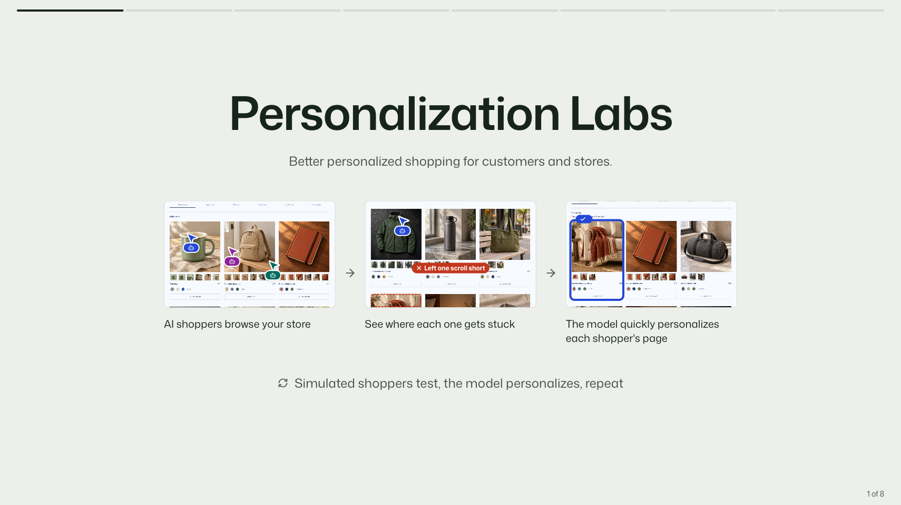
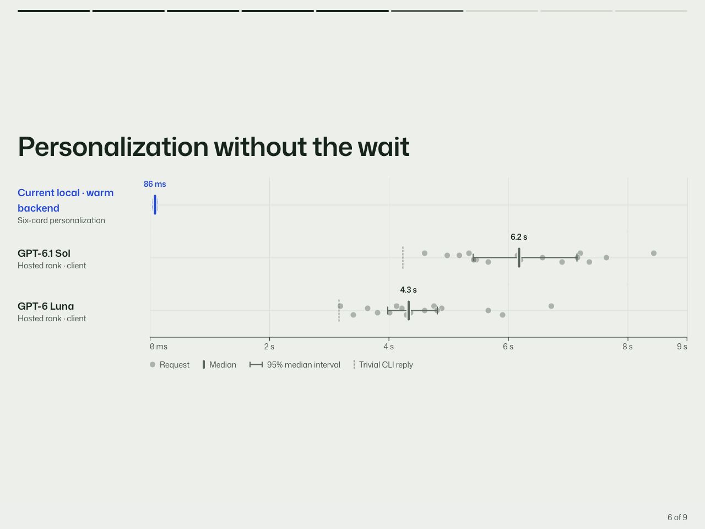
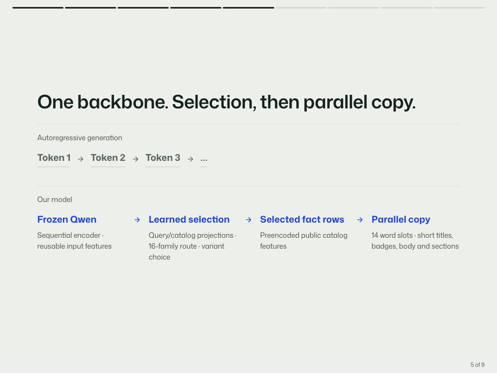

# Personalization Labs

**A storefront that learns what fits each shopper—and a lab that tests it.**

Built at DubHacks 2026, Personalization Labs pairs AI shopper experiments with a
local model that selects products, chooses colors and writes fresh catalog-grounded
copy. Shoppers get a page shaped around their request; merchants get a way to test
how that page performs.



## The results

| Result | What we measured |
| --- | --- |
| **+3.78% merchandise value per session** | **$42.35 → $43.95** in a synthetic benchmark: 60 paired scenarios, 120 assigned sessions. |
| **86 ms warm personalization** | **85.5 ms median** backend time across 10 six-card requests, with warm input encoding and fresh ranking/copy on every request. |
| **139 ms to visible personalized products** | **138.8 ms median** to three fully visible cards with decoded images across 10 loaded-shop profile switches. |
| **35 products · 105 color variants** | The current demo selects real catalog variants and produces 20 fresh factual fields for a six-card response. |
| **29/32 correct first choices** | The earlier balanced ranker audit improved from **14/32**, with the target present in the top six for **32/32** requests. |

The value result uses the frozen 16-product synthetic cohort; speed measurements
use the expanded 35-product demo. Warm backend timing excludes startup, network,
browser and images. [Sources, methodology and full outcomes](docs/RESULTS.md).

## Personalization without the wait



The local series measures warm six-card personalization. The hosted series measure
earlier ranking requests through the client; their workloads and timing boundaries
differ. [Timing sources and scope](docs/RESULTS.md#speed-graph).

## Watch the loop

1. **Test the store.** Screenshot-driven AI shoppers browse the generic and personalized shops, search, choose products and try the simulated checkout.
2. **See the friction.** Compare suitable purchases, abstentions, shopper actions and merchandise value using saved session evidence.
3. **Personalize the page.** A local Qwen backbone feeds learned product and color selection, then a parallel word head writes titles, badges and short copy from catalog facts.
4. **Run it again.** Compare immutable experiment snapshots in the presentation dashboard.

The demo shop is called **Fieldwork**. It supports product galleries, color choices,
a cart and simulated checkout. Budgets and supported hard constraints gate product
selection; generated copy stays tied to selected catalog facts.

## Built for fast personalization



A frozen **Qwen3.5-9B** backbone supplies reusable input features. Small learned
heads handle product selection, color choice and parallel copy prediction. Warm
requests reuse exact input features while recomputing scores, selections and words.
This gives the demo fresh six-card responses without generating every word through
a long autoregressive sequence.

[Serving architecture](experiments/ranker/pretrained/STORE_EXPANDED_ENGINE_V1.md) ·
[Current measurements](experiments/ranker/pretrained/expanded_store_results/v1/CURRENT_LIVE_SUMMARY.json) ·
[Experiment history](docs/DEVELOPMENT.md#measured-status)

## Run the demo

Use Node 24.11+ in the 24.x line or Node 26+, pnpm 12.5.1, and Go 1.24+ with CGO
and a C compiler. The default shop uses SQLite and requires no model weights or API key.

```sh
pnpm install
pnpm seed
pnpm dev
```

| App | Address |
| --- | --- |
| Presentation dashboard | <http://dubhacks.localhost:1356> |
| Fieldwork storefront | <http://shop.dubhacks.localhost:1356> |
| Go API | <http://api.dubhacks.localhost:1356> |

The results presentation uses the configured Tiger results connection. On the
configured Apple silicon machine, `pnpm dev:personalized:demo` starts the expanded
local-model demo at <http://127.0.0.1:4313>; it requires the existing local weights
and checkpoints. [Full setup and local prerequisites](docs/DEVELOPMENT.md#run-the-default-demo).

The presentation supports arrow-key navigation. Its title, observed results,
speed chart and learning loop tell the project story; detailed evidence remains
available through the final evidence slide and [results guide](docs/RESULTS.md).

## Explore the project

| Area | Code and documentation |
| --- | --- |
| Storefront | [React shop](apps/storefront/) |
| Presentation | [React slide deck](apps/web/src/CohortPresentation.tsx) |
| Experiment API | [Go API](apps/api/README.md) |
| AI shopper evaluation | [Runner and protocol](apps/runner/SHOPPER_COHORT.md) |
| Local model | [Native experiments and serving](experiments/ranker/pretrained/) |
| Setup, audits and historical measurements | [Development guide](docs/DEVELOPMENT.md) |
| Product direction | [Vision](VISION.md) |

Personalization Labs is the project name; Fieldwork is its demonstration store.
Repository: [quick007/personalization-labs](https://github.com/quick007/personalization-labs).

## License

[MIT](LICENSE) © 2026 DubHacks project contributors. Third-party dependencies and
model artifacts retain their respective licenses and notices.
